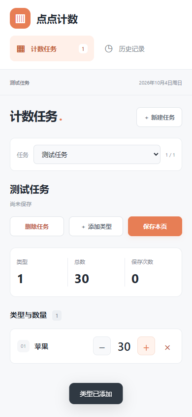

# 点点计数

点点计数是一个离线使用的任务计数器，提供浏览器版和 Android 版。网页由 HTML、CSS 和 JavaScript 构成，打开即可使用；Android 版在系统 WebView 中运行同一套页面。日常使用不需要联网或账号，也不依赖第三方服务。

当前版本：**1.0.4**。更新内容见 [CHANGELOG.md](CHANGELOG.md)。

## 可以做什么

- 建立多个任务，为每个任务添加计数类型；点击类型名称加一，也可用 `−`、`+` 调整数值，最低为 0。
- 点击“保存本页”记录当前任务的全部类型和数量；之后继续计数不会修改已保存的页面。
- 在“历史记录”中查看保存记录和每次加减明细，搜索记录，或删除单条历史。
- 从“历史记录”导出全部数据，或导出某次保存的页面，文件格式为 JSON。**当前没有导入功能。**
- 删除任务或类型时保留已有历史；最后一个任务删掉后显示空列表。首次打开也没有预设任务，需要点击“新建任务”。

数据保存在当前浏览器或 Android 应用的本地 IndexedDB 中。电脑浏览器、不同浏览器和手机应用各自保存数据，不会自动同步。请定期导出 JSON 留档；清除浏览器或应用数据、卸载应用可能使本地记录丢失。浏览器版请固定使用同一个浏览器和文件位置打开，避免无痕模式。旧版已有数据会保留；没有内容的旧版默认任务会移除。

## 界面预览

下面的图片使用隔离测试数据，图片中的任务和数字不包含在下载包中。

[查看电脑界面](preview.png) · [查看首次打开的空列表](preview-empty.png)

## 下载与首次使用

在 [最新版发布页面](https://github.com/wobuyaoquminga/diandian-counter/releases/latest) 下载：

- **电脑浏览器：**`diandian-counter-web-1.0.4.zip`。解压后双击 `index.html`，首次进入点击“新建任务”。
- **Android 8.0 及以上：**`diandian-counter-1.0.4.apk`。在手机上打开 APK 并按系统提示允许安装；安装后点击“新建任务”。安装和更新细节见 [Android 说明](android/README.md)。
- **文件校验：**`SHA256.txt` 列出发布文件的 SHA-256 摘要，可用于核对下载文件。

Android 版需要可用的 Android System WebView；若提示组件版本问题，请更新系统 WebView 或 Chrome。发布文件以发布页面实际提供的内容为准。

## 从源码运行与验证

克隆仓库后，直接用浏览器打开根目录的 `index.html`。网页使用仓库内文件，不需要安装依赖。Windows 上构建 Android APK 的环境和命令见 [Android 说明](android/README.md)。

安装 Node.js 后，可在项目根目录运行 `node --test store.test.js` 检查计数和历史数据逻辑。浏览器检查另需安装 Playwright 和 Chromium，可运行 `node tests/browser-check.cjs`；需要时可通过 `PLAYWRIGHT_MODULE` 指定 Playwright 模块位置、`BROWSER_EXE` 指定浏览器程序。1.0.4 已通过 13 项单元测试和浏览器检查；APK 已通过签名、对齐及内置资源校验。尚未完成真机安装和系统文件选择器导出的实测。

## 参与和许可

问题与建议可通过 GitHub Issues 提交；修改代码前请看 [贡献说明](CONTRIBUTING.md)。项目以 [GNU Affero General Public License v3.0 only](LICENSE) 发布。
